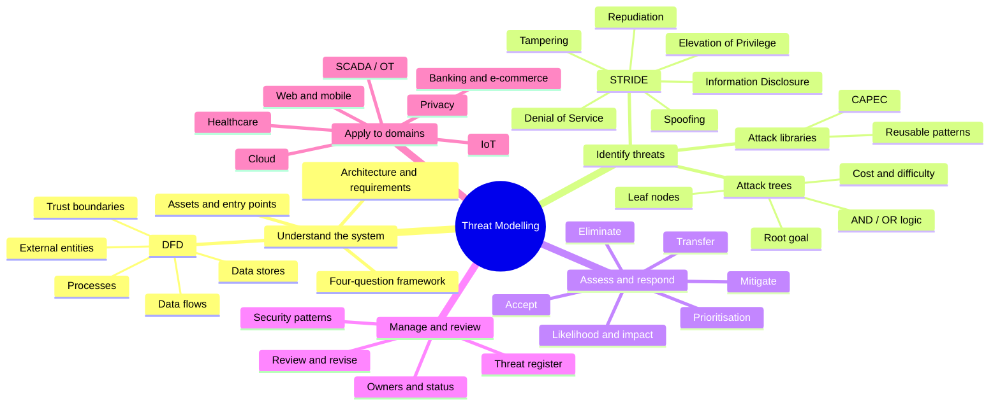
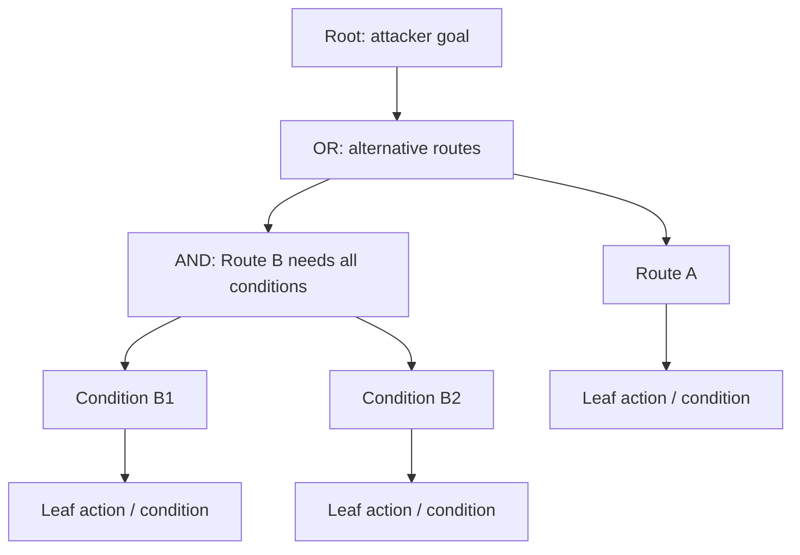
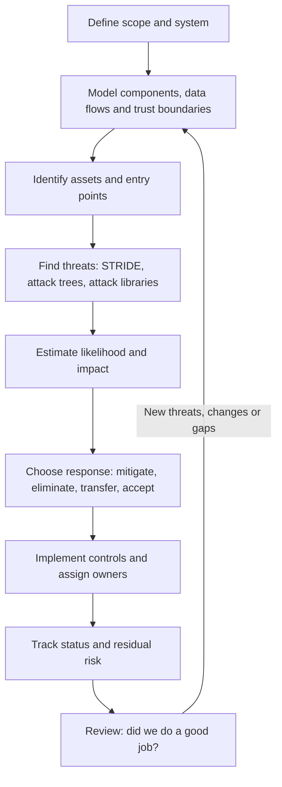
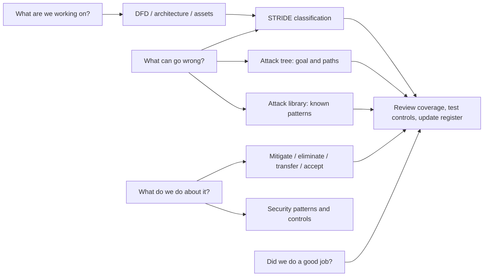
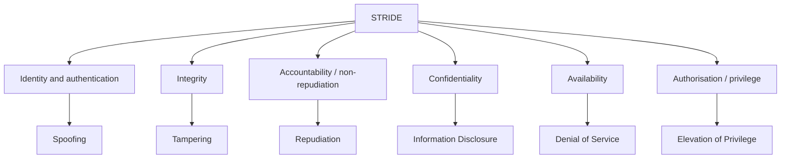

# Cyber Threat Modelling — Notes

# 1. Master knowledge tree

## The four-question framework — learn this in order

| Question | What it asks | Typical output |
|---|---|---|
| **1. What are we working on?** | Understand requirements, architecture, data flows, assets, components, users and trust boundaries. | System scope and model, often a DFD. |
| **2. What can go wrong?** | Identify threats, weaknesses, attacker goals and plausible attack scenarios. | Threat list, STRIDE analysis and/or attack tree. |
| **3. What are we going to do about it?** | Select and assign responses to the threats or risks. | Mitigations, elimination, transfer or documented acceptance. |
| **4. Did we do a good job?** | Check coverage, assumptions, controls and unresolved risks; revise where needed. | Reviewed, updated threat model and tracked actions. |

**Recall cue:** **Understand → Identify → Respond → Review.**

This is iterative: a design change, new dependency, new threat or failed control can send the team back to an earlier question.

## Threat modelling approaches

| Approach | Starting point | Focus | Example prompt |
|---|---|---|---|
| **Asset-centric** | What needs protection? | Asset value, sensitivity, business impact and consequences of loss. | What happens if patient reports are disclosed? |
| **Attacker-centric** | Who might attack, and why/how? | Adversary goals, capabilities, motives and plausible attack paths. | How could an outsider or malicious insider gain access? |
| **Software-centric** (also called architecture-centric) | How is the system built? | Components, interfaces, data flows, trust boundaries and design weaknesses. | Where can the app/API/database boundary introduce threats? |

The three perspectives are complementary; using more than one can improve coverage.

---

# 2. DFDs, assets, entry points and trust boundaries

## What is a Data Flow Diagram (DFD)?

A **DFD** is a graphical representation of how data moves between system components. In threat modelling, it helps make components, data exchanges and trust boundaries visible so threats can be identified systematically, including with STRIDE.

### Main DFD elements

| Element | Meaning | Typical examples |
|---|---|---|
| **External entity** | A user or external system interacting with the system being modelled. | Patient, customer, payment provider, identity provider. |
| **Process** | A component that receives, transforms or acts on data. | Mobile app backend, API, authentication service, checkout service. |
| **Data store** | Data retained for later use. | User database, medical records, order database, audit log. |
| **Data flow** | A directed exchange of data between elements. Label it with the kind of data or request. | Login credentials, API request, report response, transfer instruction. |
| **Trust boundary** | A boundary where trust level, administrative control or security assumptions change. | Public internet to API; app tier to database; customer tenant to provider-managed service. |

A trust boundary is an important modelling overlay; it may not be drawn using the same symbol set as the four basic DFD elements.

### DFD checklist

- Define what is inside and outside the system scope.
- Include external users/systems, key processes, data stores and **labelled, directional** flows.
- Mark trust boundaries and ask what security assumptions change at each boundary.
- Identify exposed entry points: web routes, API endpoints, login forms, file uploads, admin interfaces, device interfaces, message queues and third-party integrations.
- Identify valuable assets and sensitive data crossing or stored inside each boundary.
- Do not treat a DFD as proof that the system is secure; it is a map used to guide analysis.

### Reusable application: hospital mobile app

For a hospital app, think in terms of **patient → mobile client → API/backend → records database**, with any external identity, notification or booking integration shown where relevant. Mark boundaries between the patient's device, public network, hospital-controlled services and database environment.

Likely **assets**: patient reports, personal/medical data, credentials/tokens, appointment records, integrity of clinical records, and availability of booking/report services.

Likely **entry points**: mobile login, password recovery, API endpoints, report-download endpoint, appointment booking/update endpoints, administrative interfaces and external integrations.

This is a reusable analysis scaffold, not a completed scenario answer.

---

# 3. STRIDE — the core threat classification framework

**STRIDE** is a set of six threat categories used to identify different classes of security failure.

| Letter | Category | Security property commonly threatened | Meaning | Simple example | Mitigation keywords |
|---|---|---|---|---|---|
| **S** | **Spoofing** | Authentication | Pretending to be another user, component or system. | Attacker uses stolen professor credentials. | Strong authentication, MFA, secure credential storage, session protection. |
| **T** | **Tampering** | Integrity | Unauthorised modification of data, code, configuration or messages. | Student's marks or a transfer amount is altered. | Server-side authorisation, input validation, integrity checks, controlled changes. |
| **R** | **Repudiation** | Non-repudiation / accountability | A user denies performing an action, and the system lacks adequate evidence to establish what happened. | Professor denies changing a grade. | Attributable, time-synchronised, tamper-resistant audit logs; suitable transaction evidence. |
| **I** | **Information Disclosure** | Confidentiality | Information is exposed to an unauthorised party. | API reveals another patient's report or exposes whether an account exists. | Least privilege, access control, encryption, data minimisation, generic error messages. |
| **D** | **Denial of Service (DoS)** | Availability | Legitimate users cannot access a service or resource. | Excessive requests exhaust login resources; vulnerable regex causes ReDoS. | Rate limits, quotas, timeouts, capacity controls, resilient architecture, DDoS protection. |
| **E** | **Elevation of Privilege** | Authorisation | A user obtains permissions beyond those intended. | Ordinary customer accesses an admin-only function. | Least privilege, server-side permission checks, role separation, secure configuration. |

**Memory cue:** **S-T-R-I-D-E** = **Identity, Integrity, Accountability, Confidentiality, Availability, Authorisation**. These are the useful property associations for this question bank.

### Important distinctions

- **Spoofing vs Tampering:** Spoofing is about **who/what is claiming an identity**; Tampering is about **unauthorised change**.
- **Repudiation vs Tampering:** Tampering alters information; Repudiation concerns denial and insufficient evidence/accountability. One incident can involve both.
- **Information Disclosure vs account enumeration:** Revealing whether an account exists is a small but real disclosure that can help an attacker plan further attacks.
- **DoS vs DDoS:** DoS describes the availability impact; DDoS is a distributed form in which many sources contribute traffic or requests.
- **Elevation of Privilege vs Spoofing:** Spoofing passes as another identity; Elevation of Privilege expands permissions. They can occur together but are not the same.

## Applying STRIDE to a login process

You only need three categories for the Group B login question, but the same method generalises to all six:

| Threat | Scenario | Mitigation |
|---|---|---|
| Spoofing | Stolen credentials are used to impersonate a user. | MFA, secure password handling, detection of credential stuffing and protected sessions. |
| DoS | High request volume or an inefficient regex exhausts login resources. | Rate limiting, quotas, request limits, safe regex design and timeouts. |
| Information Disclosure | Different messages or response behaviour reveal whether a username exists. | Generic authentication errors and consistent response behaviour. |

### STRIDE-per-element method

1. Draw or inspect the DFD.
2. Take each relevant element or flow in turn.
3. Ask which STRIDE categories apply to it; do not force every category onto every element.
4. Write each threat as a concrete statement: **actor/cause + affected element/asset + security impact**.
5. Assign a mitigation and track the remaining risk.

For a banking application, illustrative threat coverage could be:

| STRIDE | Banking example | Mitigation direction |
|---|---|---|
| Spoofing | Stolen credentials impersonate a customer. | MFA, secure sessions, anomaly detection. |
| Tampering | Transfer amount or payee is changed without authorisation. | Transaction integrity, server-side validation and authorisation. |
| Repudiation | Customer denies initiating a transfer and records are insufficient. | Attributable audit trail and transaction confirmation evidence. |
| Information Disclosure | One customer can read another customer's balance. | Object-level authorisation and least privilege. |
| DoS | Customers cannot access balances or transfer services. | Rate controls, capacity planning, resilience and recovery. |
| Elevation of Privilege | Customer can invoke administrator-only functions. | Deny-by-default authorisation and server-side role checks. |

---

# 4. Attack trees

An **attack tree** decomposes an attacker's high-level goal into smaller sub-goals and actions.

- **Root node:** The ultimate attacker goal.
- **Intermediate node:** A sub-goal or condition that supports the parent goal.
- **Leaf node:** A lowest-level action or condition considered in the model.
- **OR node:** Any one child path is sufficient to satisfy the parent.
- **AND node:** All required child conditions must be satisfied.
- **Path annotation:** Cost, difficulty, prerequisites, likelihood, detectability or potential impact can be recorded if the question asks for it.

### Logical graph

### Cost and cheapest path

- For an **OR** branch, compare the viable alternatives; the lowest-cost viable path may be the cheapest route.
- For an **AND** branch, all required child conditions must be met, so the total path cost includes every required child.
- State the assumptions behind cost estimates. A cheap path is not necessarily the most likely path or the path with the greatest impact.
- Use attack-tree analysis defensively: identify high-value cut points and protect, remove or monitor the conditions that make a dangerous path possible.

For a safety-critical system, model high-level paths and impacts carefully; prioritise prevention of unsafe state changes, monitoring, segmentation, recovery and independent safety controls.

---

# 5. Attack libraries, CAPEC and modelling tools

## Attack library

An **attack library** is a reusable, structured collection of documented attack patterns and related information that helps analysts identify and reason about threats without starting from scratch each time.

### Properties of a good attack library

1. **Comprehensive coverage:** Broad range of attack techniques, platforms, stages and relevant environments.
2. **Structured classification:** Categories and relationships make patterns searchable and comparable.
3. **Standardised descriptions:** Consistent terminology and details such as prerequisites, method, target and impact.
4. **Reusable patterns:** Patterns can be applied to similar systems and adapted to the context.
5. **Maintained and current:** Content is reviewed and updated as techniques and systems evolve.
6. **Useful mitigation information:** Helps connect an attack pattern to potential defences and residual risk.

### How it helps find threats

- Gives the team a checklist of known attack patterns.
- Stimulates scenarios that may not be obvious from the architecture alone.
- Improves consistency and coverage across reviews.
- Saves time by reusing documented knowledge.
- Helps explain the threat and inform mitigation decisions.

### CAPEC

**CAPEC** means **Common Attack Pattern Enumeration and Classification**. It is a MITRE-maintained catalogue of common attack patterns, with descriptions of how adversaries exploit weaknesses and information that can support mitigations.

Examples relevant to a web checkout or account workflow include:

- **CAPEC-66 — SQL Injection:** User-controlled input changes the intent of a database query. Defences include parameterised queries, appropriate input handling, least-privilege database accounts and safe error handling.
- **CAPEC-62 — Cross-Site Request Forgery (CSRF):** A browser is induced to send an authenticated request the user did not intend. Defences include anti-CSRF tokens, appropriate cookie settings, origin checks where suitable, and re-authentication/confirmation for sensitive actions.
- **CAPEC-593 — Session Hijacking:** Weaknesses in session handling allow an attacker to use or manipulate an active session. Defences include TLS, secure cookie settings, session rotation/expiry, protection against token leakage and re-authentication for sensitive actions.

Choose patterns that match the actual system's features; these are examples, not a claim that every checkout has all three vulnerabilities.

### Do not confuse these resources

- **STRIDE:** A classification framework that prompts analysts to consider six types of threat.
- **Attack tree:** A goal-oriented representation of how an attack objective can be decomposed into sub-goals and paths.
- **Attack library (e.g., CAPEC):** A reusable catalogue of documented attack patterns.
- **MITRE ATT&CK:** A knowledge base of adversary tactics and techniques based on observed behaviour; it is related to, but not interchangeable with, CAPEC.

### Tools from the question bank and this revision

| Tool | Type | High-level use |
|---|---|---|
| Microsoft Threat Modeling Tool | Tool commonly used for diagram-based threat modelling | Build system diagrams and identify threats, including STRIDE-oriented analysis. |
| OWASP Threat Dragon | Open-source | Create DFD-style threat models, record threats and mitigations. |
| OWASP pytm / PyTM | Open-source, code-based | Define a model in Python and generate model artefacts/reports. |
| IriusRisk | Commercial platform | Threat modelling, security requirements and workflow integration. |

**Open-source vs commercial:** Open-source often offers source visibility, flexibility and no licence fee, with support varying by project. Commercial tools often offer vendor support, enterprise collaboration and managed workflow features, usually with licensing costs. Actual capabilities vary by product and edition; avoid absolute claims like “all open-source tools are basic.”

---

# 6. Threat response, prioritisation and tracking

## Four ways to address a threat

| Response | Meaning | Example |
|---|---|---|
| **Mitigate** | Reduce the likelihood or impact by applying controls. | Add MFA and login rate limits to reduce account-compromise risk. |
| **Eliminate** | Remove the source of the threat or exposure, often by removing a feature, service or unnecessary attack surface. | Disable an unnecessary exposed service. |
| **Transfer** | Shift some financial or operational consequences to another party through arrangements such as insurance or contracts. The underlying threat may remain. | Cyber insurance covers certain eligible incident costs. |
| **Accept** | Make an informed, documented decision to tolerate a risk, often because it is low or further treatment is disproportionate. | Accept a low-impact residual risk after assessment and approval. |

**Recall cue:** **M-E-T-A** = Mitigate, Eliminate, Transfer, Accept.

Be precise: **isolation/containment** is an incident response action that can help limit damage; it is not one of the four formal risk-treatment choices listed in this question bank.

## Prioritising threats

A practical first-pass approach is to consider:

- **Impact:** What happens if the threat succeeds? Consider confidentiality, integrity, availability, safety, legal obligations and business disruption.
- **Likelihood:** How plausible is exploitation given exposure, required access, attacker capability, existing controls and known weaknesses?
- **Risk:** Combine likelihood and impact using the organisation's chosen method or risk matrix. If a simple matrix is used, state that it is a qualitative estimate rather than a precise measurement.
- **Priority modifiers:** Exploitability, reachability, affected asset value, safety implications, regulatory exposure, control gaps and dependencies.
- **Treatment:** Assign an owner, mitigation, target date and residual-risk decision.

Do not prioritise solely by how technically interesting a vulnerability is. A lower-complexity threat to a safety-critical or highly sensitive asset may deserve urgent attention.

## Threat register / tracking table

A threat register is a maintained list of identified threats and their treatment progress. It supports documentation, prioritisation, assignment, accountability and review.

Recommended columns: **ID, asset/element, threat description, STRIDE category, likelihood, impact/risk, mitigation, owner, status, due date, residual risk**. For the question-bank table, the minimum required fields are ID, description, STRIDE category, mitigation and status.

| ID | Threat description | STRIDE | Mitigation | Status |
|---|---|---|---|---|
| T-01 | Unauthorised user reads another user's file. | Information Disclosure | Enforce server-side object-level authorisation; test access boundaries. | Open |
| T-02 | Attacker modifies a file without permission. | Tampering | Apply least privilege, authorised write operations and integrity monitoring. | In progress |
| T-03 | Excessive requests exhaust an API. | Denial of Service | Apply quotas, throttling, timeouts and capacity protections. | Planned |
| T-04 | User denies performing a sensitive change. | Repudiation | Record attributable, time-synchronised and protected audit events. | Open |

Status values should be unambiguous, such as **Open, In progress, Mitigated, Accepted, Closed**. A status should reflect evidence, not optimism.

## A good threat-modelling project

1. Define scope, purpose, system owners and assumptions.
2. Gather architecture/design details and build the DFD.
3. Identify assets, entry points, trust boundaries and dependencies.
4. Identify threats using STRIDE, attack trees and/or relevant attack libraries.
5. Assess likelihood/impact and prioritise.
6. Choose mitigations or other risk responses; assign owners and dates.
7. Track evidence of implementation and remaining risk.
8. Review when the system, threat landscape, dependencies or assumptions change.

---

# 7. Defensive tactics and security patterns

A **security pattern** is a reusable design solution to a recurring security problem. A pattern is not a guarantee: it must be selected and implemented for the system's context.

| Security need / threat area | Defensive tactics and technologies |
|---|---|
| Identity / Spoofing | MFA, secure password storage, identity federation configured securely, protected sessions, phishing-resistant authentication where suitable. |
| Integrity / Tampering | Server-side validation, parameterised database access, access control, integrity checks, signed updates and controlled change management. |
| Accountability / Repudiation | Attributable audit logs, trusted time synchronisation, protected/centralised log storage, monitoring and appropriate transaction evidence. |
| Confidentiality / Information Disclosure | Least privilege, encryption in transit and at rest, data minimisation, secret management and object-level authorisation. |
| Availability / DoS | Rate limits, quotas, timeouts, resource caps, queue controls, redundancy, DDoS protection and tested recovery. |
| Authorisation / Elevation of Privilege | Deny by default, least privilege, RBAC/ABAC, server-side checks on every sensitive operation, separation of duties and hardened configuration. |
| Privacy | Minimise collected data, limit retention and use, control access, aggregate or anonymise where appropriate, and provide transparency and consent where required. |

**Patterns worth naming in answers:** least privilege; defence in depth; fail securely; deny by default; complete mediation (check authorisation on every relevant request); secure defaults; segmentation; secure logging/monitoring; validated input and parameterised queries.

---

# 8. Privacy threats and mitigations

## Common privacy threat types

| Threat type | What goes wrong | Example |
|---|---|---|
| Excessive collection | More personal data is collected than required. | A booking app collects unnecessary sensitive details. |
| Unauthorised access or disclosure | Personal data is seen by the wrong party. | A user accesses another patient's report. |
| Excessive retention | Data is retained longer than necessary. | Old identity records remain indefinitely without purpose. |
| Linkability / re-identification | Separate data sets or supposedly anonymous records can be linked back to a person. | A published dataset is combined with public records to infer identities. |
| Unintended secondary use | Data is used for a new purpose users did not expect. | Appointment information is repurposed for unrelated profiling. |
| Tracking, profiling or inference | Behaviour or sensitive attributes are inferred from activity data. | A service infers sensitive interests from usage patterns. |
| Lack of transparency/control | People cannot understand or control relevant data practices. | Unclear notice about sharing or retention. |

## Mitigation techniques

- **Data minimisation:** Collect and process only the data needed for a legitimate purpose.
- **Anonymisation:** Transform data so it cannot reasonably be linked to an identifiable person. Re-identification risk must be assessed, especially when datasets can be combined.
- **Pseudonymisation:** Replace direct identifiers with substitute values; the data may still be linkable using additional information, so it is not the same as anonymisation.
- **Access control and encryption:** Restrict who can use data and protect it in storage and transit.
- **Aggregation and privacy-preserving analysis:** Reduce detail where possible; stronger methods such as differential privacy may be appropriate for some statistical releases.
- **Retention and deletion controls:** Define retention periods and securely remove data no longer needed.
- **Purpose limitation and transparency:** Restrict reuse, document purposes, and provide appropriate notice and choices.
- **Audit and governance:** Review access and processing, assign responsibility, and check that controls work.

## Privacy vs data utility

More transformation and less detail can reduce re-identification risk but also reduce usefulness for analytics, research or service delivery. The goal is not to maximise either privacy or utility in isolation; select the least detailed data that still supports a justified purpose, assess re-identification risk, and document the trade-off.

---

# 9. Web, cloud, mobile, IoT and SCADA concepts for Group C

These are domain-specific applications of the same core process: scope the system → map data and trust boundaries → identify threats → choose controls → track residual risk.

## Web application threats

| Threat / weakness | Typical impact | Mitigation direction |
|---|---|---|
| Broken access control / IDOR | User reads or changes another user's resource. | Server-side object-level authorisation; deny by default; test horizontal and vertical access. |
| Injection (e.g., SQL injection) | Unintended database or command interpretation, data exposure or modification. | Parameterised queries, safe APIs, least privilege and context-aware validation. |
| Authentication and session flaws | Account takeover or session misuse. | MFA, secure password reset, secure cookies, session rotation and expiry. |
| Cross-site scripting (XSS) | Script executes in another user's browser context. | Context-aware output encoding, safe templating and appropriate content security controls. |
| Cross-site request forgery (CSRF) | Browser sends an unwanted authenticated state-changing request. | Anti-CSRF tokens, cookie controls, origin checks where appropriate and confirmation for high-risk actions. |
| Server-side request forgery (SSRF) | Server is induced to make unintended network requests. | Restrict outbound destinations, validate parsed destinations, segment services and block sensitive metadata/internal endpoints. |
| Security misconfiguration / secrets exposure | Debug endpoints, default settings or credentials expose the system. | Secure defaults, secret management, configuration review and removal of unused services. |
| Denial of Service / ReDoS | Service or application resources are exhausted. | Resource/time limits, rate controls and safe parsing/regex design. |
| Insecure deserialisation or unsafe data formats | Untrusted input triggers unexpected object/state behaviour. | Avoid unsafe native deserialisation, use constrained formats and validate types/structure. |

Do not rely on client-side checks for security-critical decisions. Enforce authentication, authorisation, validation and business rules on the server.

## Cloud security and shared responsibility

The **shared responsibility model** divides security duties between cloud provider and customer. The provider secures the underlying cloud service/infrastructure; the customer secures what they deploy, configure, access and store, with the exact split depending on the service model.

| Area | Provider-side concerns | Customer / tenant-side concerns |
|---|---|---|
| Infrastructure | Physical facilities, underlying hardware and foundational service operations. | Select suitable services and configure them safely. |
| Identity and access | Provider platform controls for its own workforce and service. | Customer IAM, MFA, roles, credentials, permissions and tenant identities. |
| Data and applications | Service features and controls supplied by the provider. | Data classification, application security, access rules, keys and safe use of service features. |
| Configuration | Secure operation of the managed service. | Storage exposure, network rules, public endpoints, logging and backup settings within customer control. |
| Incident response | Provider investigates incidents in its responsibility boundary and supplies agreed evidence. | Customer monitors its workloads, protects credentials, responds to account/application incidents and meets its obligations. |

### Common tenant/customer threats

- Overly permissive IAM roles or stolen cloud credentials.
- Publicly exposed storage or databases due to misconfiguration.
- Insecure application/API code or weak tenant isolation in the customer's own software.
- Unprotected secrets, poor logging, untested backups or excessive privileges.

### Common provider-side threats

- Weaknesses in underlying infrastructure or managed-service implementation.
- Provider control-plane compromise or failures affecting many tenants.
- Physical infrastructure or foundational service availability failures.

The precise allocation varies among **IaaS, PaaS and SaaS**: customers generally manage more of the stack in IaaS and less in SaaS, but customers still retain responsibilities such as identity, data use and secure configuration where exposed. Do not assume “the provider secures everything.”

## Mobile application threats

- **Insecure local storage:** Sensitive tokens or records are stored unsafely on the device.
- **Insecure communication:** Requests or tokens are exposed due to weak transport protection.
- **Weak authentication/session handling:** Credentials or tokens can be stolen or misused.
- **Insecure APIs:** Server-side authorisation or validation is missing.
- **Hard-coded secrets / reverse engineering:** Secrets embedded in an app can often be recovered; obfuscation alone is not a security boundary.
- **Excessive permissions and unsafe platform interfaces:** The app exposes more device capabilities or data than necessary.
- **Outdated vulnerable components:** Libraries or operating systems are not maintained.

Countermeasures: minimise local sensitive data; use platform secure storage; use TLS; use short-lived and revocable tokens; enforce authorisation on the server; minimise permissions; protect deep links/exported components; update dependencies; and avoid embedding long-lived secrets in client applications.

## IoT smart-home threats

Threats span devices, local networks, mobile apps, cloud backends and APIs:

- Default or weak credentials and poor account recovery.
- Insecure communications and exposed device services.
- Unsigned or unreliable firmware updates; unsupported devices.
- Insecure mobile/cloud APIs and weak authorisation.
- Privacy leakage from sensors, occupancy data or usage history.
- Device compromise used as a foothold into the home network.

Mitigations: unique credentials, MFA for management accounts where suitable, signed updates and secure boot where supported, encrypted communication, minimal exposed services, network segmentation, least privilege, vulnerability/patch lifecycle management, protected APIs and data minimisation.

## SCADA / operational technology (OT)

A water-treatment SCADA system is safety-critical: a cyber event can affect **physical process integrity, availability and human safety**, not only data confidentiality.

High-level threat concerns include unauthorised control commands, altered sensor/telemetry data, compromised operator accounts, loss of visibility, disruption of control services and unsafe configuration changes.

Defensive priorities include:

- Segmentation between IT, OT, control networks and external access paths; tightly control remote access.
- Strong authentication and least privilege for engineering and operator accounts.
- Allowlisting and hardened configurations for critical hosts where practical.
- Monitor configuration and command changes with protected audit records.
- Validate control changes and use change-management procedures.
- Maintain safe operating limits, independent safety interlocks, manual/fail-safe procedures and tested recovery plans.
- Test changes in safe, controlled environments; avoid unapproved active testing against live safety-critical control systems.

When evaluating an attack path, prioritise prevention of unsafe state changes and safety consequences, not just confidentiality loss.

---

# 10. Scenario workflow for 15-mark questions

Use the same sequence for the hospital, banking, SCADA, e-commerce, IoT, cloud and privacy scenarios. This section gives a reusable scaffold rather than fully solving each supplied scenario.

## Suggested answer structure

1. **Restate scope and objective** (1–2 sentences).
2. **Describe the model**: list major users, processes, data stores, external systems, data flows and trust boundaries. If asked to draw a DFD, label the flows and boundaries clearly.
3. **List assets and entry points**: make these separate lists; an asset is what needs protection, while an entry point is where interaction or input reaches the system.
4. **Apply a method**: STRIDE-per-element, the four questions, attack tree, attack library or privacy analysis, as requested.
5. **Use a threat table**: each row should have a specific threat and a matched mitigation.
6. **Prioritise** using likelihood, impact, safety/business consequences and existing controls.
7. **Track and review**: assign status/owner, mention residual risk, and state that the model is revisited after design changes or new evidence.

## High-yield checklist by Group C question

| Question | Concepts to have ready |
|---|---|
| **C1 Hospital app** | Level-1 DFD; trust boundaries; assets vs entry points; four-question framework; privacy/confidentiality; API access control. |
| **C2 Online banking** | STRIDE-per-element; all six categories; threat + specific mitigation for each; transaction integrity, authentication, availability and accountability. |
| **C3 Water-treatment SCADA** | Attack-tree goal/sub-goals; AND/OR; cost/difficulty labels; cheapest viable path; safety and physical process impact; segmentation, authorised control, monitoring, fail-safe and recovery. |
| **C4 E-commerce checkout** | Attack-library properties; choose relevant CAPEC patterns; compare STRIDE (classification), attack tree (goal/path decomposition) and library (reusable attack knowledge). |
| **C5 IoT smart home** | Project scope and lifecycle; assets and entry points; threat register with ID, description, category, mitigation and status; treatment options. |
| **C6 Cloud file sharing** | Controls for all STRIDE categories; security patterns; prioritisation; shared responsibility, IAM, storage exposure, data protection and availability. |
| **C7 Privacy** | Types of privacy threats; mitigation techniques; anonymisation vs pseudonymisation; privacy–utility trade-off. |
| **C8 Web + cloud + mobile** | Common web threats and mitigations; provider vs tenant responsibilities; mobile storage, communication, authentication, APIs, permissions and update controls. |

---

# 11. The connected maps

## End-to-end workflow

## Which method answers which question?

## Six STRIDE categories connected to the CIA triad and access control

---

# 12. Exam-writing templates

## One-mark question

Give the exact term or one-sentence definition. Avoid burying the answer in a long paragraph.

**Template:** “**[Term]** is [precise meaning].” Add one example only if requested.

## Five-mark explanation/comparison

A reliable structure is:

1. Define the concept or state the basis of comparison.
2. Explain 3–5 distinct points in bullets or a table.
3. Give a relevant example.
4. Add a short conclusion if useful.

For **threat + mitigation** questions, use a separate pairing for each threat. The mitigation must address the stated threat rather than being a generic “use encryption.”

## Fifteen-mark scenario

Allocate space according to the marks for each subpart. Use labelled diagrams/tables where requested. Include a concrete system-specific threat, the affected asset/component, impact, and matched mitigation. Do not spend most of the answer defining STRIDE if the marks are for applying it to the scenario.

### Table pattern for threat analysis

| ID / element | Threat category | Specific threat | Impact | Mitigation | Priority/status |
|---|---|---|---|---|---|
| T-01 | One STRIDE category | Actor/cause + target + consequence | C/I/A, safety or business impact | Control that addresses this threat | High/Medium/Low; owner/status if asked |

---

# 13. Closed-book retrieval check

Answer these without looking back. Give yourself credit only when you can state the concept accurately and provide an example where required.

1. What are the four questions in the threat-modelling framework, in order?
2. What are the four basic DFD elements, and what does a trust boundary indicate?
3. Expand STRIDE and map each letter to its security-property association.
4. Distinguish Spoofing from Elevation of Privilege.
5. Distinguish Tampering from Repudiation.
6. What do the root, AND, OR and leaf nodes mean in an attack tree?
7. How do AND and OR affect a path-cost calculation?
8. What is an attack library? Name CAPEC and give one attack-pattern example.
9. Compare STRIDE, attack trees and attack libraries in one sentence each.
10. Name the four threat-response choices and give one example of each.
11. What belongs in a useful threat register?
12. Distinguish asset-centric, attacker-centric and software-centric modelling.
13. How can account enumeration be an Information Disclosure threat?
14. Give one control each for Spoofing, Tampering, Repudiation, Information Disclosure, DoS and Elevation of Privilege.
15. Explain the shared responsibility model and why service model matters.
16. Give three privacy mitigation techniques and explain anonymisation versus pseudonymisation.
17. Name two mobile threats, two IoT threats and two SCADA/OT defensive priorities.
18. For a new scenario, can you identify its assets, entry points, trust boundaries, threats, mitigations and residual risks?

## Self-marking rule

For each question, mark **2** = correct and complete, **1** = partly remembered or vague, **0** = missed. Revisit every 0 and 1. The purpose is to expose gaps before the exam, not to measure ability from a single reading.

---

# 14. Last-minute memory sheet

- **Four questions:** What are we working on? → What can go wrong? → What are we going to do about it? → Did we do a good job?
- **STRIDE:** Spoofing–Authentication; Tampering–Integrity; Repudiation–Accountability/non-repudiation; Information Disclosure–Confidentiality; DoS–Availability; Elevation of Privilege–Authorisation.
- **DFD:** External entities, processes, data stores, directional data flows; mark trust boundaries.
- **Approaches:** Asset = what to protect; attacker = who/how; software = architecture and flows.
- **Attack tree:** Root = ultimate goal; AND = all children; OR = any child; leaves = lowest-level actions/conditions.
- **Attack library:** Reusable patterns; CAPEC = Common Attack Pattern Enumeration and Classification.
- **Methods are different:** STRIDE classifies; attack trees decompose goals; libraries provide known patterns.
- **Responses:** Mitigate, eliminate, transfer, accept.
- **Threat register:** Record, prioritise, assign, mitigate, track and review.
- **Privacy:** Minimise collection/retention; protect access; anonymise cautiously; acknowledge utility trade-offs.
- **Cloud:** Provider secures underlying cloud services; customer/tenant secures identities, data and customer-controlled configuration/workloads according to service model.
- **Scenario answers:** Map system → identify assets/entry points → analyse threats → match mitigations → prioritise and track.

---

# References and further reading

These external references supplement the question-bank terminology; use the exam's wording where it differs.

- [MITRE CAPEC — About CAPEC](https://capec.mitre.org/about/index.html): purpose and use of attack patterns.
- [CAPEC-66 — SQL Injection](https://capec.mitre.org/data/definitions/66.html): description and defensive mitigations.
- [CAPEC-62 — Cross-Site Request Forgery](https://capec.mitre.org/data/definitions/62.html): attack pattern and mitigations.
- [CAPEC-593 — Session Hijacking](https://capec.mitre.org/data/definitions/593.html): session attack pattern.
- [CAPEC-115 — Authentication Bypass](https://capec.mitre.org/data/definitions/115.html): authentication-bypass pattern.
- [OWASP Threat Dragon](https://owasp.org/projects/threat-dragon): open-source threat-modelling diagrams and threat tracking.
- [OWASP Threat Dragon documentation](https://www.threatdragon.com/docs/): tool documentation.

